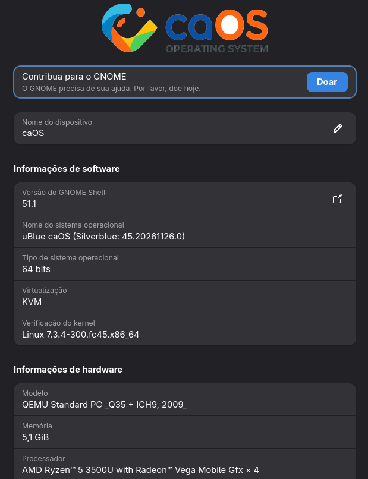

# caOS

Esta é minha distro Linux de uso pessoal baseada no “Universal Blue”. Ajustes foram feitos para tornar o sistema mais
limpo, seguro e personalizado através do uso de configurações default seguras e auditadas.

Neste momento, a distro é baseada no Fedora Silverblue, mas seria interessante no futuro baseá-la no
[Fedora Hummingbird](https://fedoramagazine.org/fedora-hummingbird-linux-taking-the-hummingbird-model-to-the-full-os/).

## Situação Atual

As images OCI produzidas por este repositório são listadas em:
<https://github.com/portfolio-2026br/caOS/pkgs/container/caos>.

O "novo" sistema operacional funciona adequadamente:

### Notas e Problemas Encontrados

- Não consigo instalar o Little Snitch durante o build, mas a instalação posterior funciona normalmente.

Para migrar para meu OS:

- Use `sudo bootc switch ghcr.io/portfolio-2026br/caos`

Situação do OS:

- Use `rpm-ostree status`;
- Ou `sudo bootc status`.

#### Atualização do OS

Para apenas verificar se há atualizações adicione a opção `--check` ao comando. Note que há muita semelhança entre os
comandos `rpm-ostree` e `bootc`.

- O comando `rpm-ostree upgrade [--check]` funciona;
- O `sudo bootc upgrade [--check]` funciona mas é frágil: não podem existir pacotes layered.

Próximos Passos:

- Copiar hardening da distro `secureblue`.
- Dúvidas:
  - Ocorre alguma notificação automática que há uma versão nova do OS que eu posso instalar?
    - Nem no Silverblue acontece. Então, a resposta é não;
    - Faça uma checagem manual usando `sudo bootc upgrade --check`.
